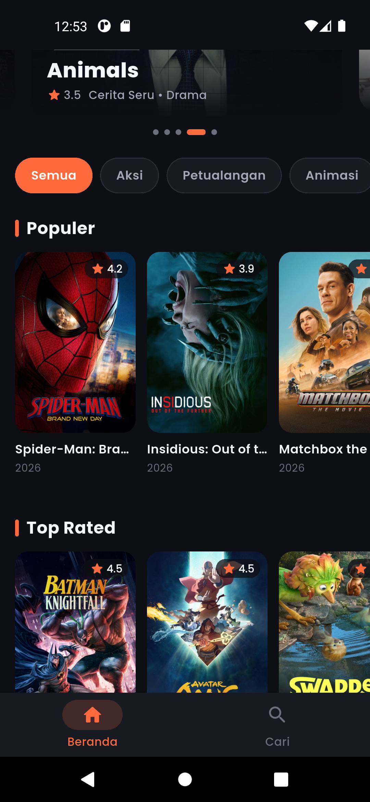
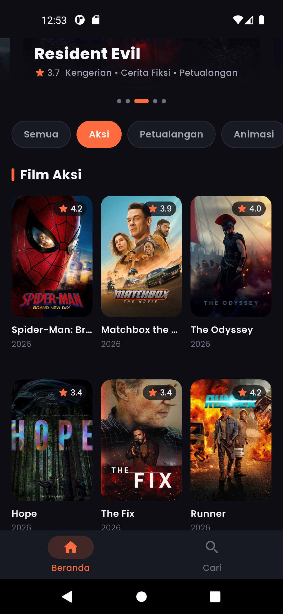
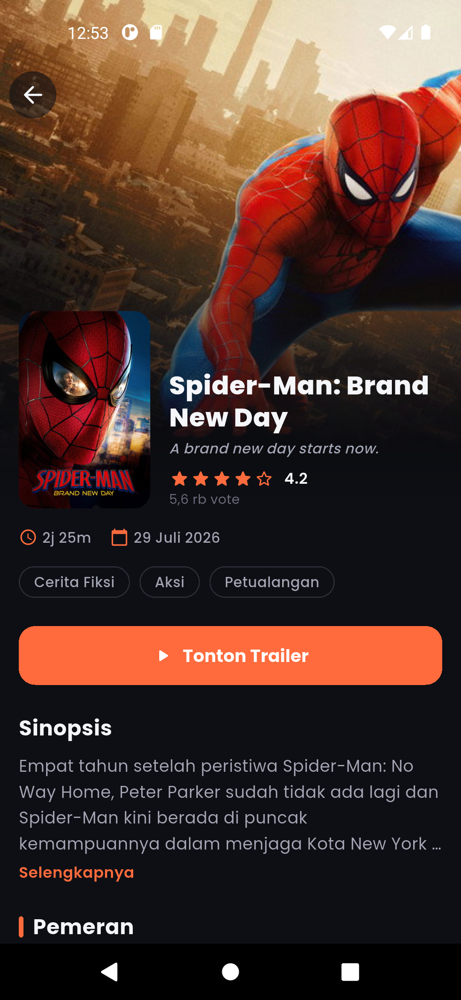
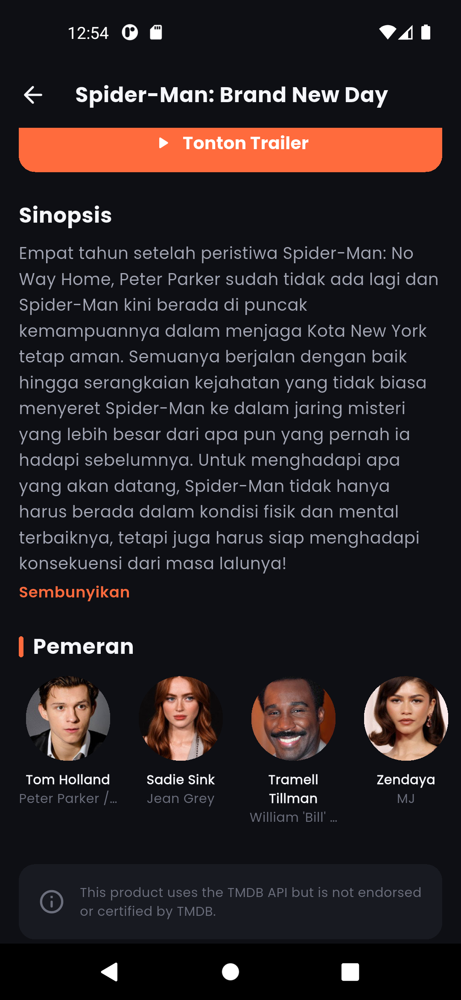
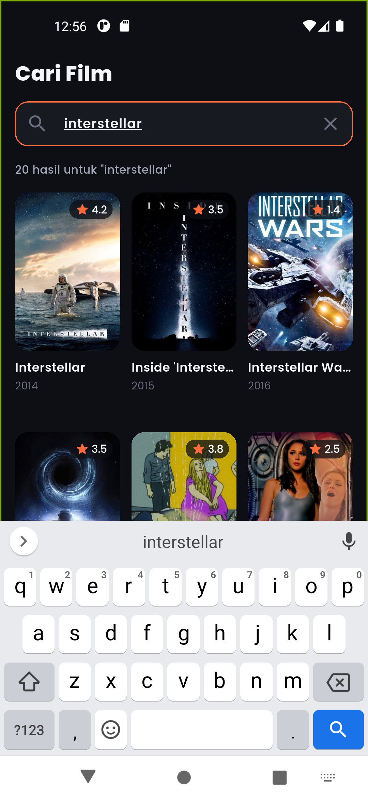
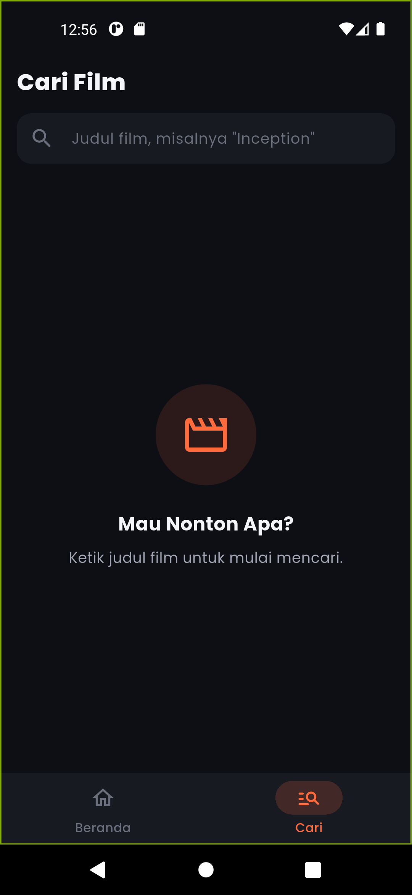
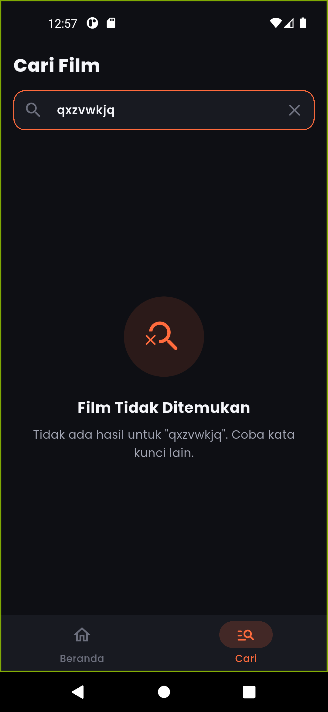
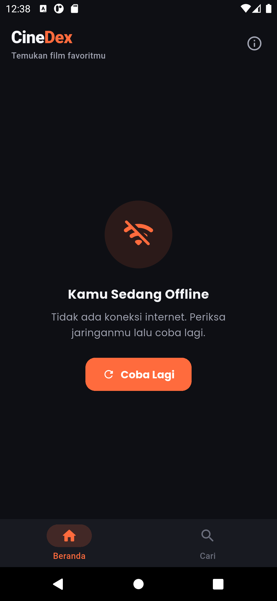

# CineDex

Aplikasi mobile **penjelajah film** berbasis Flutter yang mengambil data dinamis dari
[TMDB API v3](https://developer.themoviedb.org/docs). Temukan film yang sedang tayang, populer,
berperingkat tinggi, dan yang akan tayang, cari film berdasarkan judul, lalu lihat detail lengkap
beserta pemeran dan trailernya.

## Screenshot

| Beranda | Filter Genre | Detail | Detail (Pemeran) |
|:-:|:-:|:-:|:-:|
|  |  |  |  |

| Pencarian | Belum Mengetik | Tidak Ditemukan | Offline |
|:-:|:-:|:-:|:-:|
|  |  |  |  |

## Fitur

**Beranda**
- Hero carousel 5 film yang sedang tayang (PageView + indikator halaman, bergeser otomatis)
- Chip genre horizontal untuk memfilter film; chip "Semua" mengembalikan tampilan awal
- Section horizontal: Populer, Top Rated, Akan Tayang
- Pull-to-refresh

**Pencarian**
- Kolom cari dengan debounce 500 ms, hasil dalam grid poster
- State belum mengetik, tidak ada hasil, loading, dan error

**Detail Film**
- Backdrop dan poster dengan animasi Hero dari kartu
- Judul, tagline, rating bintang (skala 5), jumlah vote, durasi, genre, tanggal rilis
- Sinopsis yang bisa di-expand, 10 pemeran teratas
- Tombol "Tonton Trailer" yang membuka YouTube

**Umum**
- Dark theme dengan satu warna aksen, font Poppins
- Loading shimmer, pesan error ramah + tombol "Coba Lagi", deteksi tanpa koneksi internet
- Bottom navigation (Beranda, Cari) dan halaman Tentang

## Teknologi

| | |
|---|---|
| Framework | Flutter 3.44 / Dart 3.12 |
| State management | `provider` (ChangeNotifier) |
| HTTP | `http` (timeout 15 detik, exception khusus) |
| Package lain | `flutter_dotenv`, `cached_network_image`, `intl`, `google_fonts`, `shimmer`, `url_launcher` |
| Platform | Android |

## Cara Menjalankan

### 1. Prasyarat
- Flutter SDK 3.44 atau lebih baru (`flutter doctor` tanpa masalah untuk Android)
- Emulator Android atau perangkat fisik

### 2. Dapatkan token TMDB
1. Daftar akun gratis di [themoviedb.org](https://www.themoviedb.org/signup).
2. Buka **Settings → API** ([themoviedb.org/settings/api](https://www.themoviedb.org/settings/api)) lalu ajukan API key (pilih penggunaan *Personal/Educational*).
3. Salin **API Read Access Token** (string panjang yang diawali `eyJ...`).

### 3. Buat file `.env`
Salin `.env.example` menjadi `.env` di root project:
```bash
cp .env.example .env        # Windows (cmd): copy .env.example .env
```
lalu isi tokennya:
```
TMDB_READ_TOKEN=eyJhbGciOi...
```
> File `.env` sudah ada di `.gitignore`, jadi tidak ikut ter-commit. Jangan menaruh token di kode.

### 4. Jalankan
```bash
flutter pub get
flutter run
```

### Menjalankan test
```bash
flutter analyze
flutter test
```

## Struktur Folder

```
lib/
├── main.dart                 # load .env, data tanggal id_ID, runApp
├── app.dart                  # daftar provider, tema, halaman awal
├── core/
│   ├── config/               # env.dart (membaca token)
│   ├── constants/            # endpoint API, ukuran gambar, teks statis
│   ├── theme/                # warna, ukuran/radius, tipografi, ThemeData
│   └── utils/                # formatters.dart, movie_utils.dart (pengolahan data)
├── data/
│   ├── models/               # Movie, MovieDetail, Genre, CastMember, Video
│   ├── services/             # tmdb_service.dart (semua HTTP), api_exception.dart
│   └── repositories/         # movie_repository.dart
├── providers/                # HomeProvider, SearchProvider, MovieDetailProvider
├── screens/                  # home, search, detail, about, main_screen (bottom nav)
└── widgets/                  # movie_card, hero_carousel, genre_chips, shimmer, error view, dll
test/                         # unit test formatter, model, utils, service, debounce
docs/                         # catatan laporan dan screenshot
```

Alur data: `screens/widgets → providers → repositories → services → TMDB API`.

## Kredit Desain

Tata letak dan gaya visual terinspirasi dari shot Dribbble berikut (hanya sebagai inspirasi;
logo, nama, dan aset tidak disalin):
- [Movie Streaming App](https://dribbble.com/shots/15473335-Movie-Streaming-App) oleh joe.nakul
- [CineMe: mobile app for movies and TV shows](https://dribbble.com/shots/9091818-CineMe-mobile-app-for-movies-and-tv-shows)

## Atribusi TMDB

This product uses the TMDB API but is not endorsed or certified by TMDB.

Semua data dan gambar film berasal dari [The Movie Database (TMDB)](https://www.themoviedb.org/).
